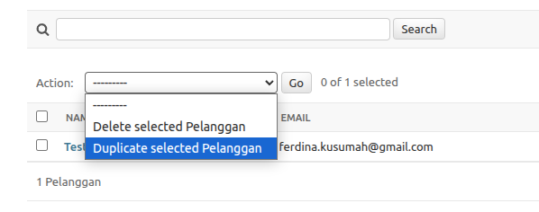
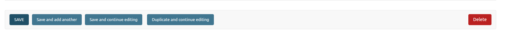

# django-duplicator

[](https://github.com/FerdinaKusumah/duplicator/actions/workflows/ci.yml)
[](https://pypi.org/project/django-duplicator/)
[](https://pypi.org/project/django-duplicator/)
[](https://pypi.org/project/django-duplicator/)

A lightweight mixin for Django Admin that adds object duplication, both in bulk (an admin action) and for single objects
(a "Duplicate and continue editing" button on the change form).

* **Single duplication**: a "Duplicate and continue editing" button on the change form opens the new copy.
* **Bulk duplication**: an admin action duplicates the selected objects from the changelist, all or nothing.
* **Data control**: exclude fields from duplication, such as unique fields or timestamps.
* **Safe by default**: duplicating needs a POST and the right permissions, and database errors are shown as messages
  instead of crashing the admin.

## Installation

```shell
pip install django-duplicator
```

Requires Python 3.10+ and Django 4.2+ (tested on 4.2, 5.2, 6.0 and 6.1).

Add `duplicator` to your `INSTALLED_APPS`:

```python
# settings.py
INSTALLED_APPS = [
    # ...
    "django.contrib.admin",
    # ...
    "duplicator",
]
```

## Usage

### 1. Model

Inherit from `DuplicatorMixin` to make a model duplicatable:

```python
# models.py
from django.db import models
from duplicator import DuplicatorMixin


class Customer(DuplicatorMixin, models.Model):
    name = models.CharField(max_length=255)

    def __str__(self):
        return self.name
```

### 2. Admin

Inherit from `DuplicatorAdminMixin` to get both the change form button and the bulk action:

```python
# admin.py
from django.contrib import admin
from duplicator import DuplicatorAdminMixin
from .models import Customer


@admin.register(Customer)
class CustomerAdmin(DuplicatorAdminMixin, admin.ModelAdmin):
    list_display = ("name", "id")
```

A user needs the **add** permission, plus **view** or **change** permission on the object, to duplicate it.

## What gets copied

* Every concrete field except primary keys, so the copy is a new row. With multi-table inheritance, the parent rows are
  new as well; the original is never modified.
* Foreign keys point to the same related objects.
* Many-to-many relations, except those with a custom `through` model (they can carry extra data, so copying them is up
  to you).
* A text field called `name` gets a ` (Copy)` suffix, shortened if needed to fit its `max_length`. Empty names are left
  as they are.

The copy is made from the **saved** object: unsaved edits on the change form are not included.

## Customization

### Excluding fields

List fields that must not be copied in `DUPLICATOR_EXCLUDE_FIELDS`. They get their default value on the copy, like on a
new record. This works for many-to-many fields too.

```python
# models.py
from duplicator import DuplicatorMixin


class Product(DuplicatorMixin, models.Model):
    DUPLICATOR_EXCLUDE_FIELDS = [
        "sku",  # unique
        "created_at",
        "last_modified",
    ]

    name = models.CharField(max_length=255)
    sku = models.CharField(max_length=100, unique=True)
    created_at = models.DateTimeField(auto_now_add=True)
```

If a copy breaks a database constraint, for example a unique field that is not excluded, the admin shows the error and
nothing is duplicated.

### Overriding values

`clone()` accepts field values for the copy:

```python
copy = product.clone(name="Product B", sku="B-001")
```

### Customizing `clone()`

Override `clone()` to adjust the copy. With `commit=False`, save the copy yourself and then copy the many-to-many
relations:

```python
class Product(DuplicatorMixin, models.Model):
    def clone(self, commit=True, **kwargs):
        copy = super().clone(commit=False, **kwargs)
        copy.sku = f"{self.sku}-COPY"
        if commit:
            copy.save()
            self.copy_many_to_many(copy)
        return copy
```

## Feature demonstration

### A. Bulk duplication (admin action)

The duplication option appears in the Actions dropdown menu on the changelist page.



### B. Single duplication (change form button)

The "Duplicate and continue editing" button is placed on the object detail page.



## Upgrading from 0.1

* The duplicate view only accepts POST. The change form button already submits a POST; if you linked to
  `<object_id>/duplicate/` yourself, submit a form instead of following a link.
* Users without permission get a 403 instead of a server error, and they need view or change permission on the object
  as well as the add permission.
* Many-to-many relations are now copied. Add them to `DUPLICATOR_EXCLUDE_FIELDS` to keep the old behaviour.
* Python 3.8 and 3.9 are no longer supported.
* Fixed: a model without its own `class Meta` became abstract (no table) because of the mixin.
* Fixed: duplicating a multi-table inheritance child overwrote the original's parent row.

## Development

```shell
make install   # poetry install
make test      # tests with coverage
make format    # black
```

## Help & Bugs

[](https://github.com/FerdinaKusumah/duplicator/issues)

If you find a bug or have a feature suggestion,
please [open an issue](https://github.com/FerdinaKusumah/duplicator/issues) or submit a pull request.

## License

[](https://opensource.org/licenses/MIT)

**django-duplicator** is released under MIT. See `LICENSE` for more details.
